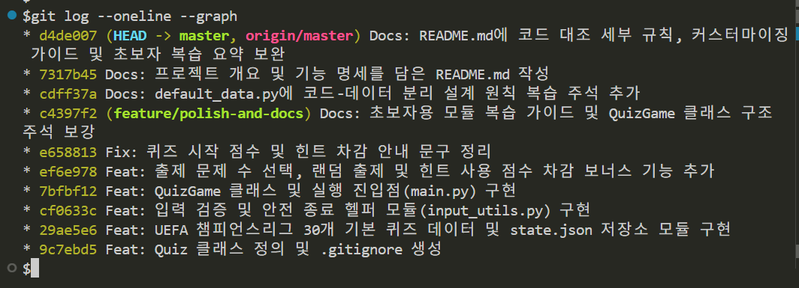

# ⚽ UEFA 챔피언스리그 CLI 퀴즈 게임 (PyQuiz-E12)

Python 3.10+ 표준 라이브러리만을 사용하여 제작된 터미널 기반 객체지향 퀴즈 애플리케이션입니다.  
코딩 입문자가 객체지향 프로그래밍(OOP), 예외 처리, 파일 입출력, Git 워크플로우를 쉽게 이해하고 복습할 수 있도록 설계되었습니다.

---

## 📌 1. 프로젝트 개요

- **개발 언어**: Python 3.10 이상
- **외부 의존성**: 없음 (100% 파이썬 표준 라이브러리만 활용: `json`, `random`, `datetime`, `sys`, `pathlib`, `typing`)
- **설계 철학**: 
  - **단일 책임 원칙(SRP)**: 각 모듈이 데이터 모델, 입출력, 검증, 게임 진행이라는 단 하나의 명확한 역할을 담당
  - **안전한 사용자 경험(UX)**: 빈 입력, 문자열 입력, 비정상 강제 종료(Ctrl+C) 상황에서도 오류 트레이스백 없이 데이터를 보존하고 안전하게 종료
  - **초보자 친화적 코드베이스**: 모든 소스 코드에 상세하고 직관적인 한국어 주석 제공

---

## 🏆 2. 퀴즈 주제와 선정 이유

- **퀴즈 주제**: **UEFA 챔피언스리그 (UEFA Champions League, UCL) 축구 상식 30문항**
- **선정 이유**:
  1. **역사와 전통**: 1955-56 시즌 초대 유러피언컵부터 2023-24, 2024-25, 2025-26 최신 결승전까지 70여 년에 걸친 유럽 축구의 찬란한 역사를 포괄합니다.
  2. **흥미진진한 스토리텔링**: 통산 최다 우승(레알 마드리드 15회), 3연패 명장 지단, 2개 구단 트레블을 달성한 펩 과르디올라, '이스탄불의 기적'과 '캄프 누의 기적' 등 축구 팬들의 심장을 뛰게 하는 명장면과 인물들을 다룹니다.
  3. **교육적 가치**: 4지선다 선택지와 함께 친절한 **힌트(Hint)** 및 정답에 얽힌 배경 이야기를 담은 **해설(Explanation)**을 제공하여 누구나 재미있게 축구 상식을 배울 수 있습니다.

---

## 🚀 3. 실행 방법

### 요구 환경
- Python 3.10 이상

### 실행 명령어
터미널에서 프로젝트 루트 디렉터리로 이동한 뒤 다음 명령어를 입력합니다:

```bash
# 공식 진입점(main.py) 실행
python3 main.py

# 또는 (환경에 따라)
python main.py
```

### 전체 게임 진행 흐름
```text
[메인 메뉴] 
  1. 퀴즈 풀기 -> 문제 수 선택(1~30) -> 무작위 출제 여부(y/n) -> 퀴즈 진행(0번 힌트 확인 가능) -> 결과 발표 및 저장
  2. 퀴즈 추가 -> 문제, 4개 보기, 정답 번호, 힌트/해설 입력 -> state.json 즉시 저장
  3. 퀴즈 목록 -> 등록된 문제, 선택지, 정답 및 힌트 확인
  4. 퀴즈 삭제 -> 삭제할 문제 번호 입력(0번 취소) -> state.json 즉시 반영
  5. 점수 확인 -> 역대 최고 점수 및 플레이 히스토리(일시, 점수, 힌트 사용 횟수) 조회
  6. 게임 종료 -> 상태 안전 저장 후 정상 종료 (Ctrl+C 입력 시에도 자동 저장 후 종료)
```

---

## 📸 4. 실행 화면 및 Git 이력 (Screenshots)

프로젝트의 Git 브랜치/커밋 히스토리 그래프와 실제 프로그램 실행 안내입니다.

### 1) Git 커밋 이력 그래프 (`git log --oneline --graph`)
브랜치 분기(`feature/polish-and-docs`) 및 병합(Fast-forward), 의미 있는 단위의 커밋 관리 이력을 터미널 그래프로 확인할 수 있습니다.

```bash
# 터미널에서 Git 커밋 그래프 확인 명령어
git log --oneline --graph --all
```



---

### 2) 퀴즈 실행 출력 확인 (`python3 main.py`)
터미널에서 애플리케이션을 직접 구동하여 메뉴 및 퀴즈 풀기 진행 화면을 확인할 수 있습니다.

```bash
# 퀴즈 게임 실행 명령어
python3 main.py
```

> [!NOTE]
> 추후 실제 플레이 및 메뉴별 동작 화면 캡처 이미지를 `docs/screenshots/` 경로에 추가할 때 아래 주석을 해제하여 바로 이어 붙일 수 있습니다.
<!--  -->

---

## ✨ 5. 주요 기능 목록

### 🎯 퀴즈 풀기 (`play_game`)
- **출제 문제 수 선택**: 현재 등록된 문제 수 범위 내에서 풀고 싶은 문제 수를 1개부터 자유롭게 지정
- **무작위(랜덤) 출제 여부**: `y` 선택 시 `random.sample()`을 통해 비복원 무작위 추출, `n` 선택 시 기본 순서 출제
- **힌트 보기 및 점수 차감**: 
  - 답안 번호 입력창에서 `0`번을 입력하면 힌트 출력
  - 힌트 확인 시 최종 점수에서 `-3점` 차감 (`HINT_PENALTY`)
  - 동일 문제에서 힌트를 여러 번 보더라도 **문제당 최초 1회만 차감**되는 중복 방어 로직 적용
  - 힌트가 등록되지 않은 퀴즈는 점수 차감 없이 "제공된 힌트가 없습니다" 안내 출력
- **점수 계산 및 최소 0점 방어**:
  - 정답 1개당 `+10점` (`SCORE_PER_CORRECT`)
  - 힌트를 많이 사용해 점수가 음수가 되더라도 `max(0, 점수)` 로직으로 **최소 0점 보장**
- **정답 판정 및 상세 해설**: 매 문제마다 정답 여부 즉시 출력 및 상세 해설 제공
- **최고 점수 갱신 및 히스토리 자동 저장**: 게임 종료 시 최고 점수 신기록 달성 여부를 알리고, 플레이 기록(날짜, 문제 수, 맞힌 개수, 힌트 횟수, 점수)을 `state.json`에 자동 저장

### ➕ 퀴즈 추가 (`add_quiz`)
- 새로운 퀴즈 문제 문장, 4개의 선택지, 정답 번호(1~4) 입력 검증
- 힌트와 해설은 선택 사항(Enter 입력 시 생략 가능)
- 입력 완료 즉시 `Quiz` 객체 생성 및 `state.json`에 영구 보관

### 📋 퀴즈 목록 조회 (`list_quizzes`)
- 현재 시스템에 등록된 모든 퀴즈의 문제, 4개 선택지, 정답 표시, 힌트 내용을 정돈된 형태로 출력

### 🗑️ 퀴즈 삭제 (`delete_quiz`)
- 번호로 지정하여 원하는 퀴즈 삭제
- `0`번 입력 시 삭제 취소 및 안전 복귀
- 삭제 즉시 `state.json`에 반영

### 🏆 점수 및 기록 조회 (`view_scores`)
- 역대 최고 점수(`best_score`) 조회
- 역대 플레이 일시, 푼 문제 수, 맞힌 정답 수, 힌트 확인 횟수, 최종 획득 점수가 담긴 히스토리 목록 출력

### 🛡️ 입력 검증 및 안전 종료 (`input_utils`)
- **공백 처리**: `.strip()`을 통한 앞뒤 불필요한 공백 자동 제거
- **유효성 검사**: 빈 입력(Enter), 숫자가 아닌 문자열, 범위 밖 숫자 입력 시 친절한 안내 후 올바른 값이 들어올 때까지 재입력 유도
- **예외 안전 종료**: 게임 진행 중 사용자가 `Ctrl+C`(`KeyboardInterrupt`)나 `EOFError`를 발생시켜도 트레이스백 에러 없이 등록된 저장 콜백(`on_exit`)을 실행해 데이터를 안전하게 저장하고 종료

---

## 📂 6. 파일 구조 및 역할 요약

```text
/home/devai/projects/pyquiz-e12/
├── quiz.py          # 단일 퀴즈 1개의 데이터 모델 (속성, 출력, 검증, 직렬화)
├── default_data.py  # UEFA 챔피언스리그 30개 기본 문제 데이터 및 초기 상태 정의
├── storage.py       # state.json 파일 입출력, 스키마 검증 및 손상 시 자동 복구
├── input_utils.py   # 안전한 사용자 입력(정수/문자열/예-아니오) 및 안전 종료 헬퍼
├── game.py          # 전체 게임 흐름 제어(QuizGame 클래스, 점수 규칙, 메뉴 처리)
├── main.py          # 프로그램 시작을 담당하는 공식 실행 진입점(Entry Point)
├── state.json       # 퀴즈 데이터 및 플레이 기록을 보관하는 JSON 영속성 파일
├── docs/            # 프로젝트 문서 및 화면 캡처 저장소
│   └── screenshots/
│       └── git_log_graph.png  # Git 브랜치 및 커밋 로그 그래프 캡처 이미지
└── README.md        # 프로젝트 전체 문서 및 사용자/개발자 가이드
```

| 파일명 | 주요 클래스 / 함수 | 핵심 역할 요약 |
| :--- | :--- | :--- |
| **`quiz.py`** | `class Quiz` | 문제, 선택지, 정답, 힌트, 해설 속성을 캡슐화하고 객체 $\leftrightarrow$ 딕셔너리 변환(`to_dict`, `from_dict`) 담당 |
| **`default_data.py`** | `DEFAULT_QUIZZES_DATA`, `get_default_state()` | 30개 UCL 상식 퀴즈 원본 데이터 보관 및 초기 게임 상태 딕셔너리 생성 |
| **`storage.py`** | `load_state()`, `save_state()` | `state.json` 파일의 안전한 UTF-8 입출력, 스키마 무결성 검사, 손상 시 기본값 복구 |
| **`input_utils.py`** | `get_int_input()`, `get_text_input()`, `get_yes_no_input()`, `safe_exit()` | 사용자 입력 정제, 유효 범위 검증, `Ctrl+C`/`EOF` 발생 시 저장 콜백 호출 및 안전 종료 |
| **`game.py`** | `class QuizGame` | 퀴즈 풀기, 문제 수/랜덤 설정, 힌트 감점, 점수 계산, 퀴즈 CRUD, 점수 히스토리 총괄 |
| **`main.py`** | `main()` | `QuizGame().run()`을 호출하여 애플리케이션을 가동하는 진입점 |
| **`state.json`** | JSON 데이터 | 퀴즈 목록, 역대 최고 점수, 플레이 일시별 기록을 저장하는 파일 |
| **`docs/`** | 스크린샷 이미지 | Git 커밋 이력 그래프 등 시각화 자료 보관 |

---

## 💾 7. 데이터 파일 설명 (`state.json`)

### 파일 경로
- 프로젝트 루트 경로: `state.json`

### 저장 역할
애플리케이션이 종료되더라도 사용자가 추가/삭제한 퀴즈 목록과 최고 점수, 플레이 이력이 유지되도록 영구 보관합니다.

### JSON 스키마 구조
```json
{
  "quizzes": [
    {
      "question": "UEFA 챔피언스리그(유러피언컵 포함) 통산 최다 우승(15회) 기록을 보유한 구단은 어디일까요?",
      "choices": [
        "AC 밀란",
        "바이에른 뮌헨",
        "레알 마드리드",
        "리버풀 FC"
      ],
      "answer": 3,
      "hint": "스페인 라리가의 명문 구단으로, 하얀 유니폼과 '갈락티코' 정책으로 유명합니다.",
      "explanation": "레알 마드리드는 1956년 초대 대회 우승을 시작으로 2023-24 시즌까지 총 15회 우승을 차지하며 독보적인 통산 최다 우승 기록을 보유하고 있습니다."
    }
  ],
  "best_score": 0,
  "history": [
    {
      "date": "2026-11-25 10:04:00",
      "total": 4,
      "correct": 3,
      "hint_used": 2,
      "score": 24
    }
  ]
}
```

### 손상 및 오류 발생 시 자동 복구 방식
1. **파일 부재 (`FileNotFoundError`)**:
   - `state.json` 파일이 삭제되었거나 존재하지 않는 경우, 안내 메시지를 출력하고 `default_data.py`의 기본 30문제와 초기 점수(`best_score: 0`, `history: []`)로 새 파일을 자동 생성합니다.
2. **파일 내용 손상 (`json.JSONDecodeError`, `UnicodeDecodeError`)**:
   - 사용자의 임의 편집이나 외부 오류로 JSON 문법이 깨진 경우, `try/except` 블록에서 오류를 포착하여 경고 메시지를 안내하고 기본 데이터로 안전하게 복구합니다.
3. **스키마 무결성 훼손 (`validate_state_schema()`)**:
   - 최상위 필수 키(`quizzes`, `best_score`, `history`) 누락, 리스트/정수 자료형 불일치, 각 퀴즈의 4지선다 및 정답 1~4 범위 미달 등이 감지되면 자동으로 기본 데이터로 초기화하여 런타임 크래시를 방지합니다.

---

## 🛠️ 8. 코드 커스터마이징 및 수정 포인트 가이드

코딩 왕초보가 게임 규칙이나 선택지 개수를 직접 변경해보고 싶다면 아래 파일의 상수를 수정하면 됩니다:

### 1) 선택지 개수 및 점수 규칙 변경 (`game.py`)
```python
# game.py 상단에 정의된 상수들
CHOICES_COUNT: int = 4        # 기본 선택지 개수 (5지선다로 바꾸고 싶다면 5로 변경)
SCORE_PER_CORRECT: int = 10   # 정답 1개당 획득 점수
HINT_PENALTY: int = 3         # 힌트 1회 사용 시 차감 점수 (0점 미만 방어 로직 내장)
```

### 2) 점수 계산 공식 변경 (`game.py` -> `calculate_score()`)
```python
def calculate_score(self, correct_count: int, total_questions: int, hint_used_count: int = 0) -> int:
    # 백분율 점수(100점 만점)로 변경하고 싶다면:
    # return max(0, round((correct_count / total_questions) * 100) - (hint_used_count * HINT_PENALTY))
    raw_score = (correct_count * SCORE_PER_CORRECT) - (hint_used_count * HINT_PENALTY)
    return max(0, raw_score)
```

---

## 🎓 9. 초보자를 위한 핵심 복습 포인트

1. **객체지향 프로그래밍 (OOP) & 캡슐화**
   - 퀴즈 1개의 데이터와 동작을 `Quiz` 클래스 하나에 모아 관리함으로써 코드 응집도를 높였습니다.
2. **단일 책임 원칙 (SRP)**
   - 데이터(`default_data.py`), 파일 입출력(`storage.py`), 입력 및 안전 종료(`input_utils.py`), 게임 흐름(`game.py`), 실행 시작(`main.py`)으로 분리하여 유지보수가 매우 쉽습니다.
3. **방어적 프로그래밍 (Defensive Programming)**
   - 빈 입력, 문자열 입력, 범위 밖 숫자, `Ctrl+C` 비정상 종료, 손상된 JSON 파일 등 모든 예외 상황을 고려하여 프로그램이 절대로 멈추지 않고 데이터를 지키도록 구현되었습니다.

